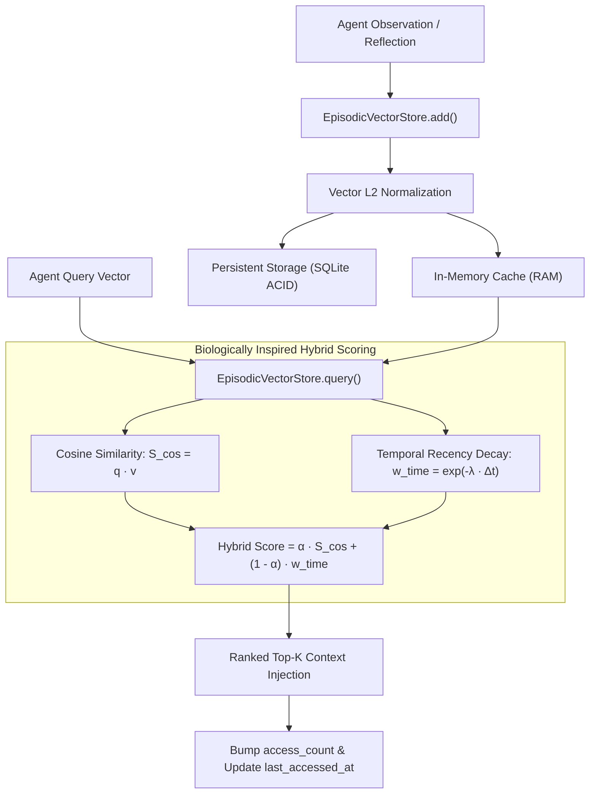

# Agentic Vector Memory 🧠💾

[](https://www.python.org/downloads/)
[](https://opensource.org/licenses/MIT)
[](https://github.com/pokushko/agentic-vector-memory)
[](https://github.com/pokushko/agentic-vector-memory)
[](https://github.com/pokushko/awesome-autonomous-agent-resilience)

A lightweight, high-performance episodic and semantic dual-store memory engine designed specifically for 24/7 autonomous AI agents. Features biologically inspired exponential memory decay, frequency-weighted access scoring, SQLite persistence, and automated compaction.

Authored by **Roman Pokushko** ([@pokushko](https://github.com/pokushko)).



---

## ⚡ Why Agent Memory Differs from Standard RAG

Standard Document RAG engines (Chroma, FAISS, Pinecone) treat all text chunks as static, eternal knowledge. However, autonomous agents in long-running loops (days and weeks) require **human-like cognitive dynamics**:
1. **Temporal Recency:** Recent errors or observations are significantly more actionable than events from weeks ago.
2. **Access Reinforcement:** Critical rules that the agent references frequently should resist forgetting even as time passes.
3. **Automated Compaction:** Background compaction must evict low-importance transient noise to preserve bounded context windows and low memory footprint.

---

## 🧮 Mathematical Formulation

### 1. Exponential Recency Decay
For any memory record $i$ accessed at time $t$, its temporal weight $w_{\text{time}}$ decays exponentially:

$$w_{\text{time}}(i) = \exp\left(-\lambda \cdot (t_{\text{now}} - t_{\text{last\_access}})\right)$$

where $\lambda$ is the configurable decay constant (e.g. $\lambda = 0.0001$).

### 2. Hybrid Retrieval Scoring
When querying with vector $\mathbf{q}$, the candidate score combines semantic alignment with recency:

$$\text{Score}(i) = \alpha \cdot \cos(\mathbf{q}, \mathbf{v}_i) + (1 - \alpha) \cdot w_{\text{time}}(i)$$

where $\alpha \in [0, 1]$ balances semantic relevance vs temporal immediacy.

### 3. Importance & Consolidation
During periodic maintenance, records with low composite importance are safely evicted:

$$\text{Importance}(i) = w_{\text{time}}(i) \cdot \left(1 + \ln(1 + \text{AccessCount}_i)\right)$$

---

## 💻 Quickstart

### Installation

```bash
git clone https://github.com/pokushko/agentic-vector-memory.git
cd agentic-vector-memory
pip install -e .
```

### Usage Example

```python
from vector_memory import EpisodicVectorStore

# Initialize store with SQLite persistence
store = EpisodicVectorStore(dimension=128, decay_lambda=0.0001, alpha=0.7, db_path="agent_memory.db")

# Store episodic memory
store.add(
    memory_id="mem_401",
    text="Encountered 429 RateLimit on LLM provider endpoint. Switched to fallback model.",
    embedding=[0.05] * 128,
    metadata={"category": "network_resilience", "severity": "medium"}
)

# Query hybrid context
results = store.query(query_vector=[0.05] * 128, top_k=3)
for record, score in results:
    print(f"Memory: {record.text} | Relevance Score: {score:.4f}")

# Evict forgotten observations older than 30 days
evicted_count = store.consolidate(min_retention_score=0.2, max_age_seconds=86400 * 30)
```

---

## 🧪 Verification & Tests

Run the unit tests suite with:

```bash
pytest tests/ -v
```

All 5 test suites verify:
- Dense cosine similarity matching.
- Exact metadata filtering.
- Temporal decay favoring recent insights over stale observations.
- SQLite disk persistence and reconstruction.
- Memory consolidation and eviction of obsolete noise.

---

## 🌐 EvoNova Labs Open-Source Ecosystem

Part of the **[EvoNova Labs](https://pokushko.github.io)** open-source AI resilience & scientific integrity stack by **[Roman Pokushko](https://github.com/pokushko)**:

| Project | Role in Stack | Link |
| :--- | :--- | :--- |
| **Awesome Agent Resilience** | Curated index (`160` entries), MAST/OWASP Failure Taxonomy & `F01–F10` chaos benchmark | [pokushko/awesome-autonomous-agent-resilience](https://github.com/pokushko/awesome-autonomous-agent-resilience) |
| **AgentBunker** | 24/7 WAL intent journal, RSS memory ceiling watchdog & tri-state circuit breakers | [pokushko/agent-bunker](https://github.com/pokushko/agent-bunker) |
| **Orchestration Engine** | Zero-dependency `asyncio` MAS router, Kahn DAG waves & consensus reducers | [pokushko/orchestration-engine](https://github.com/pokushko/orchestration-engine) |
| **Agent Security Sandbox** | Pre-flight Python AST guard against dunder escapes & prompt-injection sanitizer | [pokushko/agent-security-sandbox](https://github.com/pokushko/agent-security-sandbox) |
| **Agentic Vector Memory** | Dual-store episodic & semantic memory with exponential decay & SQLite persistence | [pokushko/agentic-vector-memory](https://github.com/pokushko/agentic-vector-memory) |
| **EvoNova Causal Guard** | Pearl *do*-calculus DAG verifier, Tabu memory & multi-agent debate arbiter | [pokushko/evonova-causal-guard](https://github.com/pokushko/evonova-causal-guard) |
| **Sci Integrity Guard** | Cross-table numeric parity linter, CrossRef/OpenAlex DOI checker & LaTeX-to-OMML | [pokushko/sci-integrity-guard](https://github.com/pokushko/sci-integrity-guard) |
| **KTK ELOU-AVT Core** | Industrial cybernetic digital twin prototype for crude oil ELOU-AVT units | [pokushko/ktk_elou_avt_core](https://github.com/pokushko/ktk_elou_avt_core) |
| **EvoNova Chem Core** | RDKit molecular descriptor screening core for physical constraint enforcement | [pokushko/evonova-chem-core](https://github.com/pokushko/evonova-chem-core) |

---

## 📄 License

MIT License. Free for open research and commercial autonomous agent deployment.
